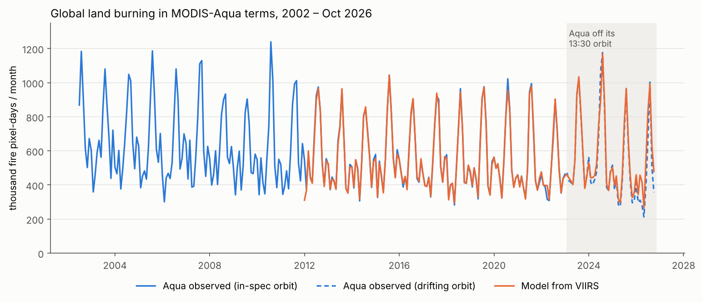
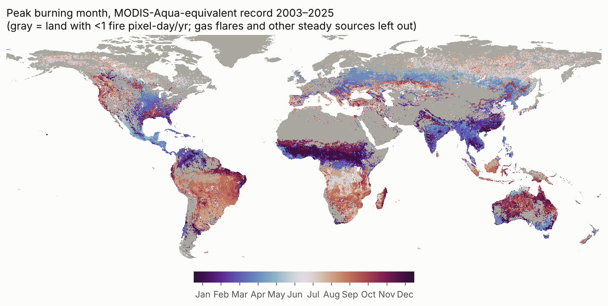
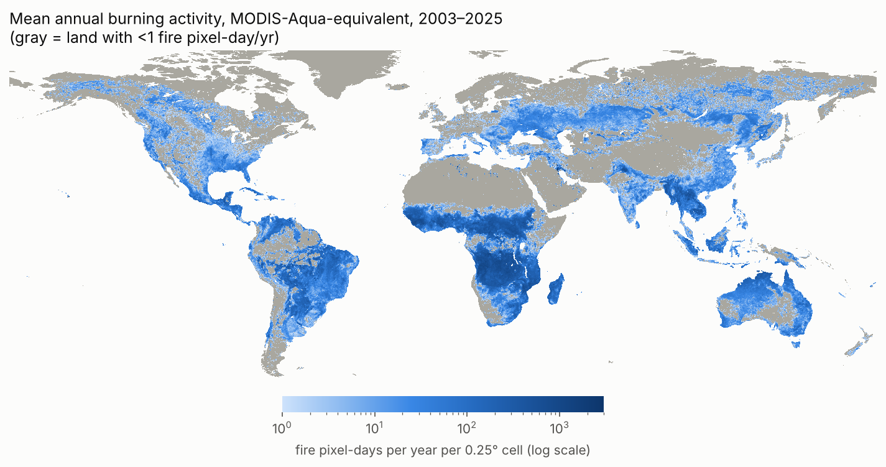

# Results — VIIRS → MODIS-Aqua-equivalent fire record (2026-11-15)

**Product model: v2** (LightGBM without fire weather and phenology). v1 kept for comparison.

All outputs are in R2 under `features/v2/ll0p25/`. Code: training table 615375f, training and
scoring 98acc60..66d4582, calendar 90da87a (see `git log`). Website/product files: `calendar_v2/`, `harmonized_v2/`, `pred_aqua_v2/`.

## Setup
- Unit: Aqua fire pixel-days per 0.25° land cell per month. There are 244,383 land cells (land fraction ≥ 0.5, latitude > −60°).
- Target: MYD14A1 fire pixel-days. Offset: S-NPP clear pixel-days. Every input still exists after MODIS ends.
- Training rows: 27.7 M cell-months, 2012-01..2023-01 (Aqua's in-spec orbit). Kept only where both sensors' month and FRP QC flags are OK and both sensors have ≥ 90 % of their usual observed days.
- QC rules:
  - Drop a sensor-month if > 5 % of its fire pixels fall on water: NOAA-20 2018-02 and 2024-02; S-NPP 2012-02/11/12, 2013-01, 2014-01/12 and 2023-11.
  - Drop a cell-month if FRP per fire pixel > 1500 MW (winter high-latitude artifacts).
  - Use NOAA-20 only from 2018-03.
  - Remove the next-January days that spill into each Aqua year file.
  - Flag 174 persistent cells (fire in ≥ 98 % of months; mostly gas flares).
- Validation: 5-fold spatial-block CV (10° blocks); a temporal back-test (train without 2019–2021, predict those years; 7.92 M rows); ablations on the back-test.

## Cross-validation (Poisson deviance, mean ± SE over 5 folds)
| Model | Deviance | Rel. bias | R² (log1p) |
|---|---|---|---|
| 1 Global ratio | 2.867 ± 0.139 | +1.0 % | 0.781 |
| 2 Ratio by land cover × month | 2.839 ± 0.129 | +0.5 % | 0.785 |
| 3 Poisson GLM | 1.330 ± 0.068 | +0.2 % | 0.789 |
| 4 LightGBM, VIIRS inputs only | 1.112 ± 0.063 | −0.2 % | 0.813 |
| 5 LightGBM, all inputs | **0.968 ± 0.053** | −2.0 % | 0.826 |

Model 5 is the simplest model within 1 SE of the best. It beats model 4 in every fold, by 0.12–0.19.

## Back-test 2019–2021
| Model | Deviance | Block-month deviance (10°) | Peak month exact / ±1 |
|---|---|---|---|
| 1 Global ratio | 2.863 | 121.7 | 72.3 % / 88.0 % |
| 2 Stratified ratio | 2.821 | 89.4 | 72.4 % / 88.0 % |
| 3 Poisson GLM | 1.302 | 143.4 | 72.4 % / 87.8 % |
| 4 LightGBM VIIRS only | 1.087 | 71.9 | 73.1 % / 88.3 % |
| 5 LightGBM all inputs | **0.908** | **17.4** | 74.3 % / 89.3 % |

Peak-month agreement is measured on the 66,625 cells with ≥ 20 Aqua fires in 2019–2021.

**Finding:** the timing of the burning season comes out almost the same for every model, even a single global ratio. Where the model choice matters is magnitude: at the 10° block-month scale, model 5's deviance is 7× lower than the global ratio's.

## Ablations (model 5 minus one group; change in back-test deviance)
| Group removed | Δ deviance |
|---|---|
| location (lat, lon) | +3.1 % |
| land cover | +1.4 % |
| season (month) | +0.9 % |
| weather (GLDAS) | +0.3 % |
| vegetation (NDVI/EVI, previous month) | +0.2 % |
| fire weather (GFWED) | −0.02 % |
| phenology (VNP22C2) | −0.02 % |
| persistent-source flag | +0.05 % |

Fire weather and phenology add nothing. Both also cause problems after MODIS ends: GFWED switches to GEOS-5, which needs calibrating to MERRA-2, and phenology has no NOAA-20 version. They are therefore dropped in the reduced model v2 (`--drop-groups fire_weather,phenology`), which is the product (see below).

## Reduced model v2 (the product)
v2 is the same LightGBM without the fire-weather (GFWED) and phenology (VNP22C2) groups.
Both groups have availability problems after MODIS ends.

| | v1 (all inputs) | v2 (reduced) |
|---|---|---|
| CV deviance | 0.968 ± 0.053 | 0.968 ± 0.054 |
| Back-test deviance | 0.908 | 0.908 |
| Back-test block-month deviance | 17.4 | 17.6 |
| Back-test peak month exact / ±1 | 74.3 % / 89.3 % | 74.3 % / 89.3 % |

The per-fold difference is within ±0.005. Peak month is identical in 99.5 % of active cells.

The two models differ only where the fire-weather input changes source. From May 2026 GFWED is GEOS-5, which reads ~22 % lower than MERRA-2 and was not yet calibrated. There, v1's predictions drop: v2/v1 = 1.015 in 2024 and 1.030 in 2026. Dropping the group removes this artifact at no cost in accuracy. v2 is therefore the product model.

v2 against observed Aqua over 2012-01..2023-01: global monthly correlation 0.992, total −0.5 %, median monthly difference 1.4 %. The calendar from v2 has 123,562 active cells, and its activity-weighted trend is −0.77 % per year.

## Final model and the harmonized record (v1 numbers; v2 above)
- **Final model:** model 5, refit on all training rows. It predicts every cell-month 2012–2026 from S-NPP, using NOAA-20 when S-NPP is missing or flagged, and as the main source from 2026-11, when S-NPP stopped.
- **Agreement with observed Aqua** over 2012-01..2023-01 (133 months): global monthly correlation 0.991; total −0.6 %; median monthly difference 1.2 %.
- **NOAA-20 vs S-NPP:** predictions from each agree within 0.2–1.4 % per year.
- **After 2023**, the model sits increasingly above the drifting Aqua (2026: model +17 %), as expected from Aqua's later overpass.
- **Feature gain:** VIIRS fire rate 70 %, fire count 20 %, FRP per fire 8 %; all covariates together < 3 %.
- **Harmonized record:** observed Aqua for 2002-07..2023-01 (scaled up for missing days, at most ×3), then the model.
- **Calendar:** a per-cell climatology for 2003–2025 in `calendar_v1/`. `calendar_cells.csv.gz` holds the 123,476 cells with ≥ 1 pixel-day per year. Activity-weighted global trend: −0.8 % per year.

## Known limits
- The calendar is monthly. A weekly calendar would need the fire masks re-summed by week.
- Missing from the bucket: phenology 2024, and some MERRA-2 FWI days (2015-06, 2024-01/02, 2025-08).
- Outputs built on EC2 have an empty commit field, because that copy of the code had no git (commits are listed above).
- Location features help most in the temporal back-test, where test and training share the same cells. The spatial CV is the stricter test.

## Comparing other models
`benchmark/benchmark_2019_2021.parquet` and `scripts/score_predictions.py` score any model (e.g. the team's CNN) on the same 7.92 M back-test rows, with the same metrics.
